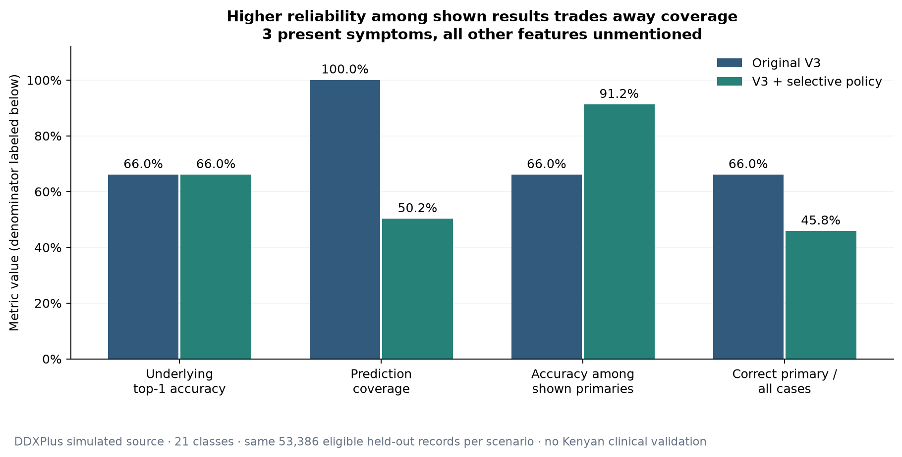

# RespiraCare — Kenyan patient experience and selective prediction

**28 October 2026. Implemented locally; no deployment or clinical validation.**

The updated local app runs at [127.0.0.1:5173](http://127.0.0.1:5173). The existing manual test account remains available. See [copy-and-paste manual test cases](RESPIRACARE_MANUAL_TEST_CASES.md).

Patients now see **at most one possible explanation**, selected by a separate evaluated decision policy. Vague or unsupported descriptions lead to relevant follow-up questions and plain uncertainty guidance. Patient results and history contain no disease confidence percentages. This work preserves the fitted V3 model and its 21 classes; it does not claim to make that model more accurate.

The measurable result is higher correctness **among selected simulated-source predictions**, accompanied by substantially lower coverage. Kenyan clinical accuracy, emergency sensitivity and patient comprehension remain unmeasured.

## 1. What the investigation found

The baseline for this request was the V3 consultation system already built earlier in this conversation, rather than the older Random Forest code still described in parts of the original READMEs. Before changing it, I saved Git heads/status, source hashes, source backups and diffs, captured 22 actual local API journeys, and ran the existing frontend checks and ten browser journeys. See `audit-artifacts/kenya-patient-experience/baseline-state.json`, `baseline-journeys.json`, `source-backup/`, and `audit-artifacts/kenya-patient-ui/baseline-browser-results.json`.

The existing flow was:

1. English, Kiswahili or mixed symptom text enters `/nlp/map`.
2. Alias/fuzzy matching proposes symptoms, with negation, uncertainty, subject and context extraction; the patient confirms positive symptoms.
3. `/predict` independently checks reported warning signs, validates age/sex and replays bounded follow-up answers.
4. V3 scores supported positive and explicitly negative evidence, marginalizing unmentioned evidence.
5. The API returned three ranked tentative conditions for recognized positive evidence. Patient current/history screens rendered all three; numeric scores could be expanded.
6. PostgreSQL stored the assessment, answers, model version, predictions and patient ownership. Separate administrator endpoints retained research records.

V3 is an age-stratified partial-evidence likelihood model, using source class frequencies and learned yes/no feature likelihoods. It has **34 native features** and **21 respiratory labels**, fitted previously on **443,075 original simulated DDXPlus respiratory training records**. Age shrinkage 1000 and temperature 0.75 were selected previously on tuning data. Sex is collected but excluded from learned V3 scores. Duration and severity guide questions/advice; they are not learned disease predictors. V1/V2 artifacts and internal comparison services remain available.

The principal weaknesses were:

- A relative winner existed even when the description did not identify a respiratory complaint. Actual baseline tiredness and headache/tiredness journeys included pulmonary neoplasm among three names. Without a clinical diagnosis, those outputs cannot be labeled diagnostically wrong; displaying specific names was nevertheless unsupported by an application eligibility decision.
- A closed 21-class score could not represent all causes of fever or headache. Missing alternatives include malaria, COVID-19 and HIV-associated illness. The legacy description dictionary had 23 entries, which did not mean V3 supported 23 classes.
- Simulated source calibration and a temperature parameter did not establish Kenyan patient probabilities. Percentages and three competing labels added apparent precision.
- Generic tiredness was mapped too readily to the source feature for constant fatigue/non-restful sleep. One everyday muscle-ache phrase was missed.
- Respiratory model questions were inappropriate for some nonspecific complaints. Exactly 14 days of cough also needed to count toward persistent-cough review advice.
- Older saved three-candidate records could bypass a new display policy unless history and cached sessions were handled explicitly.

The dataset is **simulated**, with generator and demographic assumptions described in the [DDXPlus paper](https://papers.nips.cc/paper/2022/file/cae73a974390c0edd95ae7aeae09139c-Paper-Datasets_and_Benchmarks.pdf). It is not a sample of Kenyan clinic prevalence or outcomes. No Kenyan prior was inserted and no new disease class was invented.

## 2. What changed

### Prediction and consultation

The new frozen selection policy evaluates one primary candidate instead of treating rank 1 as sufficient. It uses thresholds selected on the original tuning partition and checked on a separate source-profile cohort. A declared **90% selected-source accuracy engineering target** guides the experiment; this is not an accepted clinical threshold. One-sided exact binomial bounds and a correction for 48 evidence-count buckets decide which buckets may return a name. Failed buckets abstain without retuning against test labels. A separately checked scope override disables an additional bucket after requiring respiratory evidence.

An observed respiratory anchor is required; generic fever, pain, aches, fatigue or weight loss alone cannot establish the complaint domain. Serious classes are not banned. Unsupported wording, severe reported symptoms, contradictory evidence and unsupported evidence combinations receive explicit handling. These input checks are **not** a validated general out-of-distribution detector or a medical safety guarantee.

The API returns a versioned decision, `primary_prediction: null|object`, and `predictions: []|[the_same_primary]`. It never exports the internal selection score on patient results/history. Raw policy diagnostics are retained privately for authorized audit. V1/V2 activation cannot silently bypass the new patient policy; those versions defer a patient disease label until reassessment with the current approach, while their raw internal predictors remain testable.

There are at most **five follow-up questions**. Non-respiratory vague complaints receive duration, headache severity where relevant, and associated fever/cough questions instead of an extended respiratory checklist. Respiratory complaints check breathing first, clarify relevant context, and stop further model questions once selection is eligible. Unknown answers stay unknown; they never become denials. The existing information-gain stop rule remains for other respiratory questions. More answers do not guarantee a label: independently checked evidence buckets can have different eligibility.

Generic tiredness no longer implies constant fatigue. Persistent/non-restful wording or a relevant follow-up is needed to enable that native feature. Everyday muscle-ache variants were added consistently in both NLP implementations. No probabilities were adjusted to force influenza or suppress TB.

### Language, warnings and history

A separate maintainable, source-linked dictionary covers **all 21 exact V3 labels**, with medical names and concise English/Kiswahili names/descriptions. It corrects the displayed spelling of laryngospasm without changing the source key. URTI becomes “Nose or throat infection,” not confirmed influenza or a particular virus. Pulmonary neoplasm remains an abnormal growth that may be non-cancerous or cancerous; it is not silently renamed benign disease.

The [27-row Kenyan presentation/research table](ucs31-madhaparia-backend/docs/kenya_research.md) distinguishes local relevance, dataset membership, actual active support and clinical validation. It also maps important sources to implementation decisions. English and Kiswahili wording is an evidence-informed draft; Kenyan clinician, professional Kiswahili and patient review remain pending.

Influenza identifies influenza-virus infection; common cold and broader URTI are not interchangeable labels. Flu-like wording can describe symptoms without asserting a pathogen. Fever, cough, sore throat and aches alone are not converted to confirmed influenza. This follows the [WHO influenza explanation](https://www.who.int/news-room/fact-sheets/detail/influenza-(seasonal)) and distinctions documented in the research table. The WHO surveillance ILI definition is not used as a patient diagnostic rule.

Existing urgent respiratory handling remains ahead of routine questions and model calls, including when history storage fails. Targeted warning checks now also cover sudden unusually severe headache, headache/fever with neck stiffness, severe/crushing chest pressure, and fever in a baby when age in whole years cannot establish exact months. Fever newly disclosed during an infant follow-up also stops questions immediately, even if stale extra answers arrive. They recommend assessment without diagnosing meningitis or heart attack. Reported denials/other-person statements are respected. These are limited source-informed safeguards, not comprehensive triage. The persistent-cough boundary now includes an exact **14 days**, following the [Kenya community guideline](https://health.go.ke/sites/default/files/2025-04/Clinical%20Guidelines%20for%20Level%201%20Community%20Health%20Services.pdf); the ambiguous “3 to 14 days” answer is not assumed to mean exactly 14.

Current and saved patient results use the same one-primary contract. Older records are preserved in the database and shown as requiring a fresh assessment, rather than exposing old ranked percentages. Protected admin audit access retains historical raw records. The browser session cache version changed so an old cached assessment cannot reappear as a current result.

### Patient interface

The existing interface, navigation, authentication, confirmation, feedback and mobile layout were retained. The result component accepts one explicit primary object, never chooses `predictions[0]`, and shows familiar/medical wording, a short explanation, next steps and an optional reported-symptom disclosure. No patient score renderer remains, including in history and expanded details. Symptom word-match percentages were also removed from the UI. Routine uncertainty uses neutral blue; urgent warnings remain prominent and immediately receive keyboard focus and scroll into view, clear of navigation. Color checks cover the changed routine pair (9.05:1) and retained urgent pair (7.59:1), not a complete accessibility certification.

## 3. Actual before/after application behavior

The following table comes from the **same 22 synthetic software inputs sent to the real local API before and after**. Age 21, sex M; answer “no” to breathing difficulty and “not sure” to other unreported questions. Different answers may change the outcome. These inputs have no clinician-reviewed disease labels.

| Input | Original local API | Current local API | Current experience |
|---|---|---|---|
| “I have a headache and feel tired.” | Pulmonary neoplasm; acute rhinosinusitis; chronic rhinosinusitis | No condition name | Four relevant questions; symptoms may have several causes and are outside a complete general differential |
| “I have fever, cough, sore throat and body aches for two days.” | URTI; influenza; pneumonia | No condition name | Three follow-ups; no forced influenza/viral-cause label |
| “I have cough and a sore throat.” | URTI; influenza; bronchitis | One possible **Nose or throat infection (URTI)** | Breathing and duration questions; broad possible explanation, not confirmation |
| “I feel unwell.” | No supported condition | No condition name | Asks for actual symptoms/duration in plain language |
| “My muscles ache all over my body.” | Phrase missed; no name | Muscle aches recognized; no disease name | Duration and associated-symptom questions |
| “I am struggling to breathe.” | Urgent assessment, no names | Urgent assessment, no names | No questionnaire delay |
| “I have cough for two weeks and have lost weight without trying.” | TB; pulmonary neoplasm; acute rhinosinusitis | One possible **Tuberculosis** | Breathing question first; professional assessment advice, no claim that TB is confirmed |

TB remains possible for source-supported evidence patterns. The goal is to avoid unjustified names, not to guarantee that the app can never mention TB.

Across these 22 observations, baseline emitted three names in **15** journeys; the updated app emitted at most one in **3**, with no three-name patient result. Among the six predefined nonspecific non-respiratory probes, baseline emitted names in **5/6** and the updated app in **0/6**. All **3/3** predefined urgent respiratory inputs stayed urgent without follow-ups, and the denied breathing-warning input stayed non-urgent. These counts measure observed software behavior, not clinical error or safety rates.

Five additional real API journeys are saved in `audit-artifacts/kenya-patient-experience/additional-final-journeys.json`. **“I have intense coughing fits and vomiting after coughing for 5 days.”** gives one possible **Whooping cough** after the breathing question, with professional review advice. Itchy nose/eyes gives one source-class possibility, **Allergy-related sinus inflammation (allergic sinusitis)**. No additional matched HTTP baseline was captured for these two inputs; the unchanged raw-model native-probe rankings are recorded separately in the evaluation report. Headache/fever/stiff neck, severe sudden headache, and crushing chest pressure all returned urgent guidance without a disease name or further questions.

Desktop/mobile before-and-after screenshots and browser evidence are in `audit-artifacts/kenya-patient-ui/`. The UI evidence and limitations are documented in [frontend validation](ucs31-madhaparia-frontend/docs/frontend_kenya_validation.md).

## 4. Measured evaluation

The [full evaluation report, per-class results, matrices and data exports](ucs31-madhaparia-ml/reports/kenya_patient_experience/EVALUATION_REPORT.md) records all six sparse-evidence scenarios. The headline below uses the **same 53,386 held-out simulated-source records**, with up to three reported positive features and every other feature unknown. One additional test record has no supported positive feature and is declined by both systems. These are authentic held-out source labels from simulated DDXPlus, not real Kenyan patients or invented vignette diagnoses.

The 21-class composition is unchanged and exported in `headline_class_composition_and_coverage.csv`. There are 53,273 unique full source profiles among 53,387 retained test records. Complete source signatures cannot cross training, tuning, bound-checking, reporting validation and test. Threshold tuning uses 26,432 unique profiles; independent bound checking uses 13,507; reporting validation uses 12,905. Masks and age inputs are matched before/after. Test labels do not select thresholds. Overlapping sparse scenarios must not be added together as independent patients.

| Metric | Original V3 | V3 + selection | Change | Interpretation |
|---|---:|---:|---:|---|
| Underlying top-1 accuracy | 66.04% | 66.04% | 0.00 pp | Frozen model unchanged |
| Underlying top-3 accuracy | 94.83% | 94.83% | 0.00 pp | Internal ranking benchmark; no patient top-three output |
| Macro precision, all 21 decision classes | 83.25% | 80.83% | −2.41 pp | Abstentions produce no predicted positive class |
| Macro recall, including abstentions | 63.60% | 42.59% | −21.01 pp | Abstentions count as missed true classes |
| Macro F1, including abstentions | 66.56% | 52.42% | −14.13 pp | Lower full-population class recovery |
| Macro one-vs-rest specificity, accepted cohort | 98.17% | 99.52% | +1.35 pp | Cohort changes; not emergency/triage specificity |
| Prediction coverage | 100.00% | 50.24% | −49.76 pp | Fewer cases receive a disease name |
| Selective accuracy | 66.04% | 91.22% | +25.18 pp | Correctness among shown primary results |
| Abstention | 0.00% | 49.76% | +49.76 pp | Uncertainty is not reassurance |
| Correct primary / all cases | 66.04% | 45.83% | −20.21 pp | Selection is not improved population accuracy |
| Top-label ECE, ten equal-width bins | 0.0657 | 0.0657 | 0.0000 | Same relative scores; lower is better |
| Multiclass Brier score, sum across classes | 0.3797 | 0.3797 | 0.0000 | Same relative scores; lower is better |
| Multiclass log loss | 0.6713 | 0.6713 | 0.0000 | Same relative scores; lower is better |

Changes are calculated before rounding displayed values. One-vs-rest specificity has many negative classes and cannot establish that a serious disease has been excluded. Selection improves aggregate selected correctness but does not ensure reliable performance for every class; some source classes have zero accepted recall. Per-class CSVs retain this limitation.

One-positive/zero-negative source cases have **0% coverage**. Two-positive cases have **24.89% coverage / 91.44% selected accuracy**; up-to-eight-positive cases have **60.89% / 95.57%**. The exact three-positive/three-negative bucket failed independent checking and abstains completely. Additional application NLP, severity and warning checks are **not covered by those source-only risk bounds**. Source random masking differs from human symptom reporting; no full-application or clinical statistical guarantee is claimed.

Ten dedicated **native-feature** vague probes changed from 10/10 named source rankings to 0/10 named selective outputs. These bypass NLP and actual follow-up answers, so they differ from the 22 application journeys above; in particular, real denied breathing information can permit a broad URTI possibility. No suitable clinical reference set was available to calculate “unsupported disease error,” missed-emergency sensitivity, unnecessary referral rates, or Kenyan diagnostic accuracy. No absence of a disease name is counted as proof of safety.

### Reusable measured charts

All six charts have both PNG and SVG exports alongside the evaluation report.



- [Precision, recall and F1](ucs31-madhaparia-ml/reports/kenya_patient_experience/02_precision_recall_f1.png)
- [Matched confusion matrices, including abstention](ucs31-madhaparia-ml/reports/kenya_patient_experience/03_confusion_matrices.png)
- [Coverage versus selective accuracy](ucs31-madhaparia-ml/reports/kenya_patient_experience/04_coverage_selective_accuracy.png)
- [Native vague-probe behavior](ucs31-madhaparia-ml/reports/kenya_patient_experience/05_vague_symptom_behavior.png)
- [Source score calibration](ucs31-madhaparia-ml/reports/kenya_patient_experience/06_source_score_calibration.png)

The coverage curve is a descriptive test sensitivity analysis, not a source of new thresholds. Figures were visually checked. No illustrative numbers are presented as measurements.

## 5. Important implementation files

Paths below are relative to this workspace. Pre-existing uncommitted changes were preserved; baseline snapshots distinguish this request from the earlier work.

| Files | Purpose |
|---|---|
| ML `inference/primary_selection.py`; `models/v3_primary_selection.json`; `models/v3_primary_scope.json` | Portable primary selection, frozen checked thresholds and independent scope override |
| ML `scripts/evaluate_primary_selection.py`; `scripts/render_primary_selection_report.py`; `tests/test_primary_selection.py` | Reproducible baseline/selection evaluation, charts, policy and partition tests |
| Backend `app/ml/primary_selection.py` and both corresponding artifacts | Serving copies; runtime/model/artifact parity verified against evaluated ML copies |
| Backend `app/services/primary_assessment.py`; `app/main.py` | Explicit single-primary API, patient guidance, private diagnostics, current/legacy patient history projection |
| Backend `app/services/consultation.py`; `assessment.py`; `consultation_guidance.py`; `health_guidance.py` | Relevant bounded questions, early stop, follow-up infant-fever warning, severity/duration context and 14-day review boundary |
| Backend `app/services/assessment_safety.py` | Warning checks independent of model and history storage |
| Backend `app/data/patient_terminology.json`; `app/services/patient_terminology.py`; `docs/kenya_research.md` | Source-linked bilingual 21-class dictionary and 27-row research table |
| Both NLP `symptom_mapper.py`, English aliases and canonical symptom files | Native fatigue qualification and everyday muscle-ache wording; matching implementations preserved |
| Frontend `PossibleExplanations.jsx`, current/history pages, session hook and shared styles | Explicit one-primary rendering, no patient scores, old-cache retirement and calm presentation |
| Frontend `AdminModelCandidates.jsx` | Preserves authorized research candidate audit presentation separately |
| Backend `tests/test_kenya_patient_experience.py`, `test_primary_policy_integration.py`; updated earlier API tests | New behavior, real selective path, safety/access/history preservation and serving parity |
| Backend `scripts/audit_kenya_patient_journeys.py`; frontend `e2e/consultation-v3.pw.js` | Actual API/browser journeys and stored evidence |

The original user-edited `condition_information.json` was untouched by this request: SHA-256 `21a5120d15422622bb92a83886f48691328b49d37d00de83aa971ba963e1404c`. The V3 model hash remains `ae709ef5ddf6dd7a101fe426b610c3e83ef58aa93cb895ca13e7500220dc889c` in both repositories. Original datasets/artifacts and historical database predictions were not reset or replaced. No commit, push or deployment was performed.

## 6. Verification and reproduction

- Backend: **282 passed**, including the 45 Kenya-focused cases and eleven additional serving/NLP/real-primary/infant-follow-up checks. Uses a fresh migrated temporary schema in local PostgreSQL, never the database configured in `.env`.
- ML: **369 passed plus five subtests**. The frozen evaluation was rerun with `--evaluate-only`; the headline results above reproduced.
- Frontend: **114 unit tests**, lint and production build passed; **14/14 real Edge browser journeys passed** against the local API. These include actual primary/current/history, English/Kiswahili negation and urgent paths, vague inputs, cache retirement, empty input, mobile rendering and overflow checks. After the final warning-focus change, the **two affected urgent browser journeys passed again**, checking keyboard focus and the whole alert inside the desktop/mobile viewport. See the frontend validation document, `audit-artifacts/kenya-patient-ui/browser-after-final.txt` and `browser-urgent-final.txt`.
- Actual local API: **22 matched before/after journeys**, plus five additional final scenarios. No real patient records or clinical vignette labels were used.
- Git whitespace checks passed in all three repositories. The Windows frontend checkout reports an existing LF/CRLF normalization notice.

Earlier tests requiring three patient names/percentages were deliberately migrated to assert the new primary/uncertainty contract. Raw V2/V3 model comparison tests, authentication, ownership, feedback, validation and administrator access checks remain. Saved private diagnostics are asserted separately from sanitized patient context. A full legacy run initially identified 48 obsolete contract assertions; the final full suite passes. An interrupted local service run was restarted and excluded from final passing counts. The backend has one existing Starlette/httpx deprecation warning. Bare ML `pytest` also discovers an existing non-UTF8 readable data file as a doctest; the supported command explicitly targets `tests` and passes.

From the workspace, in PowerShell:

```powershell
# Backend: local disposable testing database, already created for this audit
cd ucs31-madhaparia-backend
$env:TEST_DATABASE_URL='postgresql+psycopg://audit_user@127.0.0.1:55432/respiracare_test'
.\.venv\Scripts\python.exe -m pytest tests -q
.\.venv\Scripts\python.exe scripts/audit_kenya_patient_journeys.py --output ../audit-artifacts/kenya-patient-experience/repeated-journeys.json

# ML: frozen policy evaluation; does not refit selection
cd ../ucs31-madhaparia-ml
.\.venv\Scripts\python.exe scripts/evaluate_primary_selection.py --evaluate-only
.\.venv\Scripts\python.exe scripts/render_primary_selection_report.py
.\.venv\Scripts\python.exe -m pytest tests -q

# Frontend: actual local API required for browsers/build configuration
cd ../ucs31-madhaparia-frontend
npm test
npm run lint
$env:VITE_API_BASE_URL='http://127.0.0.1:8000'
npm run build
npm run test:e2e
```

The API/browser scripts create synthetic local accounts and sessions. The API harness restricts hosts to loopback. Source CSVs must be present for full evaluation; a validated local cohort cache speeds reproduction. Tests do not create a Kenyan clinical reference standard. The full evaluation report provides original-policy reconstruction commands and partition details.

## 7. Source decisions and remaining limits

The research document lists 33 linked resources and explains their scope. Major decisions draw on:

- [Kenya MOH community clinical guideline (2024)](https://health.go.ke/sites/default/files/2025-04/Clinical%20Guidelines%20for%20Level%201%20Community%20Health%20Services.pdf): prolonged cough at two weeks or more and community assessment/referral context.
- [Kenya MOH primary-care guideline (2024)](https://health.go.ke/sites/default/files/2025-04/Clinical%20Guidelines%20for%20Level%202%20Dispensaries%20Medical%20Clinics%20Level%203%20Health%20Centres%20Nursing.pdf): headache/fever/neck-stiffness warning context, section 4.6.
- [Kenya malaria guideline, revised seventh edition (2025)](https://osp.nckenya.go.ke/media/uploads/1765287097AFT_REVISED_MALARIA_GUIDELINES_7TH_EDITION.pdf): locally relevant missing fever differential and testing rather than automatic symptom-based malaria treatment.
- [WHO influenza](https://www.who.int/news-room/fact-sheets/detail/influenza-(seasonal)) and [WHO surveillance definitions](https://www.who.int/teams/global-influenza-programme/surveillance-and-monitoring): pathogen, overlapping symptoms and distinction from a surveillance syndrome.
- [WHO meningitis](https://www.who.int/news-room/fact-sheets/detail/meningitis), [WHO heart attack](https://www.who.int/news-room/fact-sheets/detail/heart-attack), [NICE child fever](https://www.nice.org.uk/guidance/NG143/chapter/recommendations): targeted warning/infant safeguards without claiming to diagnose their causes.
- [NHS headache guidance](https://www.nhs.uk/symptoms/headaches/): sudden, extremely painful headache warrants emergency assessment, supporting the additional sudden-severe-headache check.
- [DDXPlus paper](https://papers.nips.cc/paper/2022/file/cae73a974390c0edd95ae7aeae09139c-Paper-Datasets_and_Benchmarks.pdf), [NIST exact binomial method](https://itl.nist.gov/div898/software/dataplot/refman2/auxillar/exacbino.htm) and the method references in the evaluation report: provenance and research-only selection checks.

Newer 2025/2026 Kenyan lung-programme documents were identified, but linked full PDFs could not be read reliably in this research run. No detailed recommendation is attributed to unread text; the research report names the accessible passages used. Reconciliation with current local guidance remains a clinician review task.

**Not demonstrated:** clinical diagnostic improvement, Kenyan prevalence calibration, safe reassurance, reduced missed emergencies, fewer unnecessary referrals, professional Kiswahili equivalence, or improved patient comprehension. Input rules and abstention cannot establish these outcomes. A 90% aggregate simulated-source research target cannot authorize clinical deployment, and weaker classes must not be hidden behind a single average.

Before use with real patients, obtain Kenyan clinician review of scope, combined/ambiguous class definitions, question relevance and triage; professional Kiswahili review and patient comprehension studies; and consented local encounter data with documented diagnostic standards and follow-up. Evaluate temporally/site-separated real cohorts, out-of-scope/mixed illness, subgroup performance, calibration, selective coverage and both missed urgent cases and unnecessary escalation, with uncertainty intervals. Whole-year infant ages remain insufficient for precise pediatric risk assessment. Adding malaria/COVID/HIV requires suitable training labels and independent evaluation, not extra dictionary entries.

## 8. Final status

- **Completed:** baseline investigation/snapshots, existing-model preservation, selective single-primary decisions, bounded relevant follow-ups, bilingual terminology resource, safety refinements, patient/history/cache UI changes, actual comparisons, evaluation pipeline, six PNG/SVG charts, source table and implementation documentation.
- **Tested successfully:** 282 backend tests, 369 ML tests plus five subtests, 114 frontend unit tests, lint/build, actual local API journeys, all 14 real browser journeys and two affected urgent-focus reruns.
- **Partially completed:** Kenya suitability investigation is evidence-informed; translations, clinical communication and warning logic still need local professional review. Accessibility checks are targeted rather than a complete audit.
- **Blocked by missing evidence:** Kenyan real-patient accuracy/calibration, clinically reviewed vignette outcomes, prospective safety/referral metrics and patient comprehension validation. Software dependencies needed for the completed checks are available locally.
- **Recommended future work:** clinician-governed local evaluation, scope and subgroup review, improved infant age capture, validated out-of-scope handling and representative data before considering retraining or deployment.
