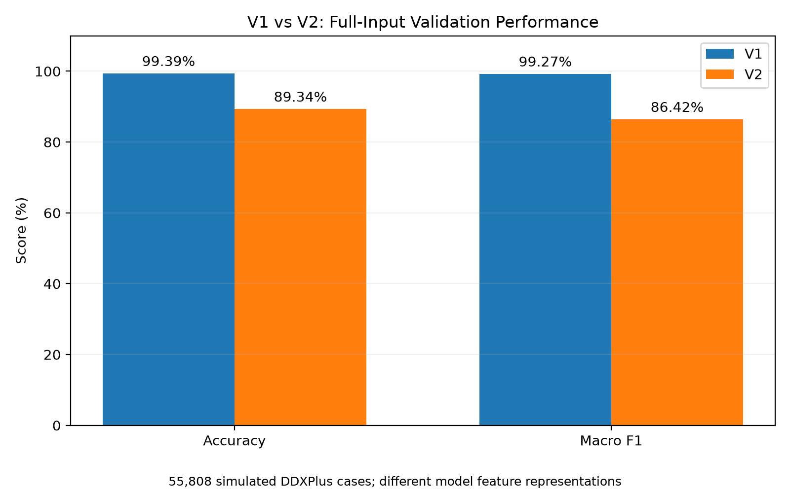
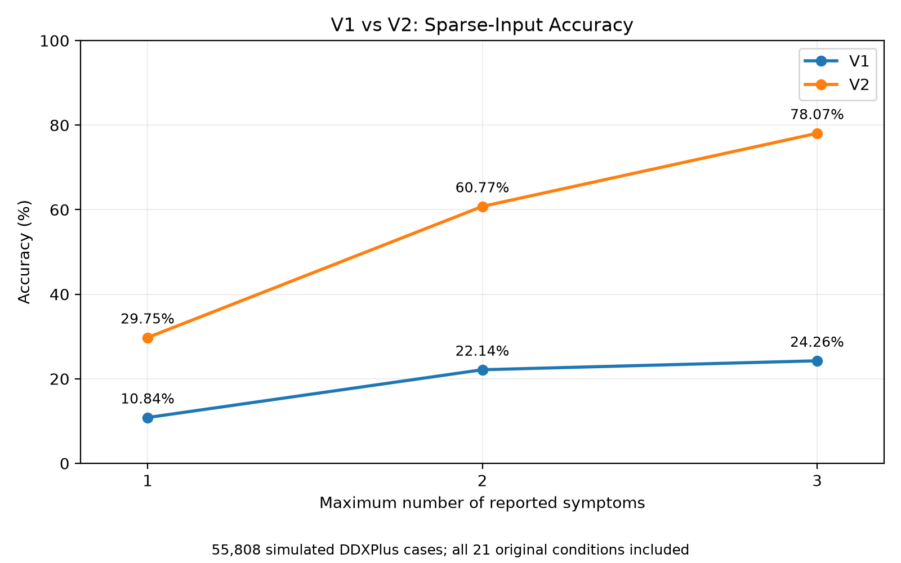
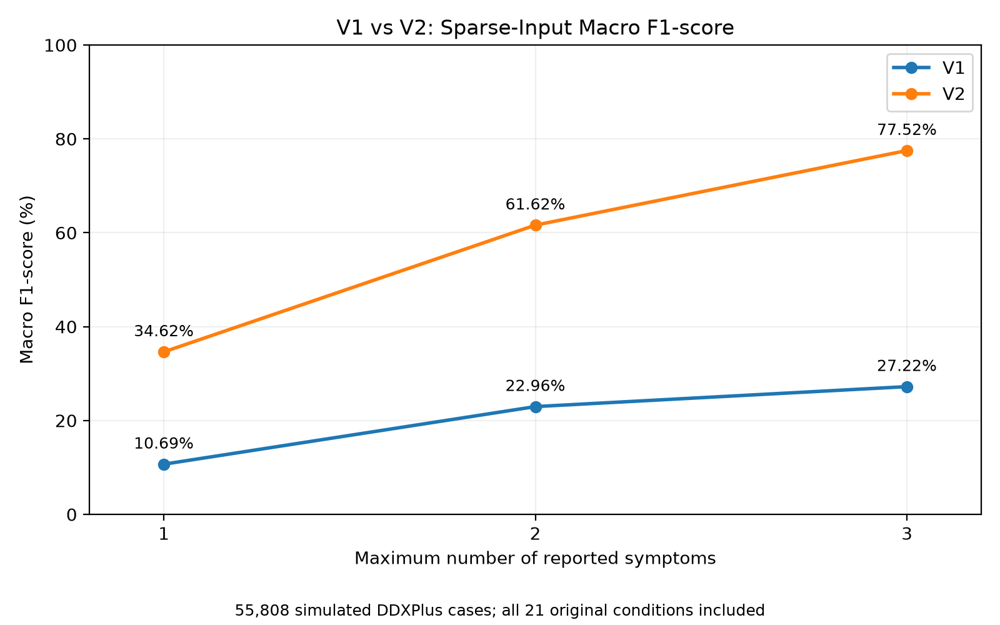

# Random Forest V1 vs V2 — Model Comparison

## 1. Purpose

This evaluation compares two saved Random Forest models developed
for the NLP-Assisted Symptom-Based Disease Prediction System.

- **V1:** Original 21-condition respiratory disease model.
- **V2:** Experimental 23-condition model, including COVID-19 and
  allergic rhinitis.

The purpose is to compare their performance on simulated DDXPlus
validation cases and assess their suitability for a system where
users provide limited symptom information.

## 2. Model Configurations

| Property | V1 | V2 |
|---|---|---|
| Algorithm | Random Forest | Random Forest |
| Prediction classes | 21 | 23 |
| Input features | 198 | 66 |
| Symptom representation | Original DDXPlus evidence encoding | Present/absent symptom features |
| Evaluation source | DDXPlus validation data | DDXPlus validation data |

Both models are research prototypes and have not undergone
independent clinical validation.

## 3. Full-Input Model Comparison

Both saved models were evaluated on the same 55,808 simulated
validation cases representing the original 21 respiratory
conditions.

| Metric | V1 | V2 |
|---|---:|---:|
| Accuracy | 99.39% | 89.34% |
| Macro precision | 99.47% | 87.48% |
| Macro recall | 99.16% | 87.87% |
| Macro F1-score | 99.27% | 86.42% |

V1 achieves higher performance when supplied with the complete
encoded patient evidence available in the dataset.

However, V1 and V2 use different feature representations and
receive different amounts of information. This comparison
therefore does not isolate model architecture as the cause
of the performance difference.

V2's two additional conditions have no independent
ground-truth cases in this evaluation, so their sensitivity
cannot be established.

## 4. Sparse-Symptom Model Comparison

A second evaluation simulated situations where patients
reported up to one, two or three supported symptoms.

The same 55,808 validation cases were retained for each test,
covering all 21 original respiratory conditions.

Age and sex were available to both models. Supported positive
evidence codes were selected reproducibly using a fixed
random seed. Patients with fewer available codes disclosed
only the codes present.

### Accuracy

| Maximum reported symptoms | V1 | V2 |
|---|---:|---:|
| 1 | 10.84% | 29.75% |
| 2 | 22.14% | 60.77% |
| 3 | 24.26% | 78.07% |

### Macro F1-score

| Maximum reported symptoms | V1 | V2 |
|---|---:|---:|
| 1 | 10.69% | 34.62% |
| 2 | 22.96% | 61.62% |
| 3 | 27.22% | 77.52% |

V2 outperformed V1 in every tested sparse-input scenario.

This suggests that V2 is better suited to the proposed
symptom-entry workflow under the simulated evaluation
conditions.

The experiment uses structured evidence codes, not actual
free-text NLP extraction. The results cannot establish
performance on real user descriptions.

## 5. Per-Condition Performance

With up to three symptoms, V2 achieved an overall accuracy
of 78.07% and macro F1-score of 77.52%.

However, recall varied between conditions.

Selected results:

| Condition | V2 recall |
|---|---:|
| Acute rhinosinusitis | 47.1% |
| Bronchospasm / acute asthma exacerbation | 50.9% |
| Pneumonia | 52.8% |
| Chronic rhinosinusitis | 63.0% |
| Influenza | 67.4% |

These results show that overall performance does not fully
represent model performance for individual conditions.

The low recall for pneumonia and acute asthma exacerbation
is particularly important. The prototype must not use a
model prediction to rule out serious illness.

Safety-related red-flag checks must operate independently
of the disease prediction model.

## 6. Train–Validation Duplicate Audit

An exact-duplicate audit compared the original respiratory
training and validation records.

| Audit finding | Result |
|---|---:|
| Training records | 443,075 |
| Validation records | 55,808 |
| Exact overlapping validation records | 2,886 |
| Exact overlap rate | 5.17% |

A separate audit using V1's 198 input features confirmed
the same 2,886 overlapping cases.

Performance was recalculated after excluding those cases.

| Model | All cases | Non-overlapping cases |
|---|---:|---:|
| V1 accuracy | 99.39% | 99.35% |
| V2 accuracy | 89.34% | 90.11% |

Removing exact duplicates changed V1's accuracy by
approximately -0.03 percentage points and V2's accuracy
by approximately +0.77 percentage points.

Exact duplication therefore does not explain V1's high
validation accuracy by itself.

However, the original training and validation datasets
contain overlapping records. Potential near-duplicates,
shared simulation patterns and other leakage mechanisms
have not been ruled out.

The non-overlapping subset is a supplementary audit,
not a fully independent replacement test dataset.

## 7. Model Selection

V2 is selected as the preferred candidate for further
development of the academic prototype.

The reasons are:

1. V2 performed substantially better with limited
   reported symptom information.
2. V2 uses a smaller feature representation designed
   around present, absent and unreported symptoms.
3. V2 supports 23 candidate conditions, compared with
   V1's 21, although the two additional conditions
   require independent validation.
4. V2 already has a prototype prediction-confidence
   and uncertainty-handling module.

V1 will be retained as the original research baseline.

This selection is based on suitability for prototype
development, not evidence of clinical readiness.

## 8. Limitations and Future Work

The evaluation has several limitations:

- DDXPlus patient cases are simulated rather than
  real-world clinical records.
- Exact train–validation overlap was identified.
- Near-duplicates and other sources of leakage remain
  possible.
- Sparse-symptom tests used randomly selected structured
  evidence codes rather than actual NLP input.
- Different symptom combinations may produce different
  results.
- The models have different training and feature
  representations.
- COVID-19 and allergic rhinitis lack independent
  ground-truth test cases.
- Some clinically important original conditions have
  insufficient recall.
- Random Forest probability outputs are not necessarily
  calibrated.
- The evaluation does not demonstrate clinical safety,
  diagnostic reliability or performance in Kenya.

Future work should evaluate the complete NLP-to-prediction
pipeline, improve performance for under-recognised
conditions, assess probability calibration and obtain
appropriate independent validation data.

## 9. Conclusion

V1 achieved the highest full-input validation performance,
but its accuracy deteriorated substantially when patient
information was restricted.

V2 performed better in the simulated limited-symptom
experiments and is therefore the preferred model for
continued prototype integration and evaluation.

Neither model is clinically validated. The system must
remain a non-diagnostic academic prototype with clear
uncertainty communication, safety guidance and limitations.
