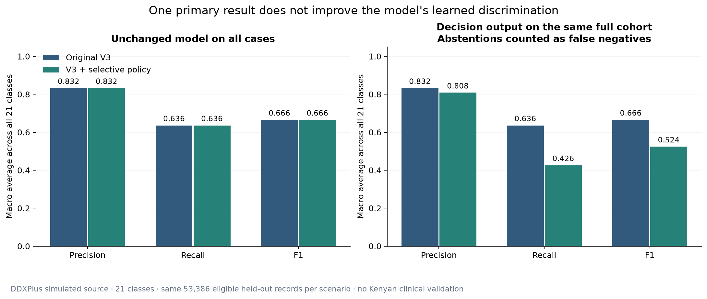
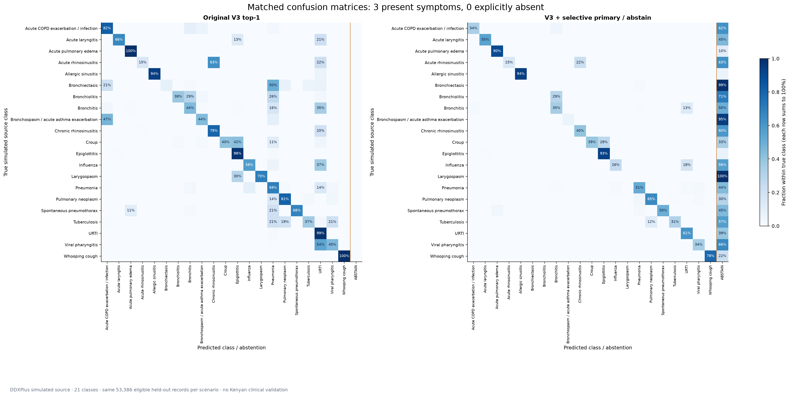
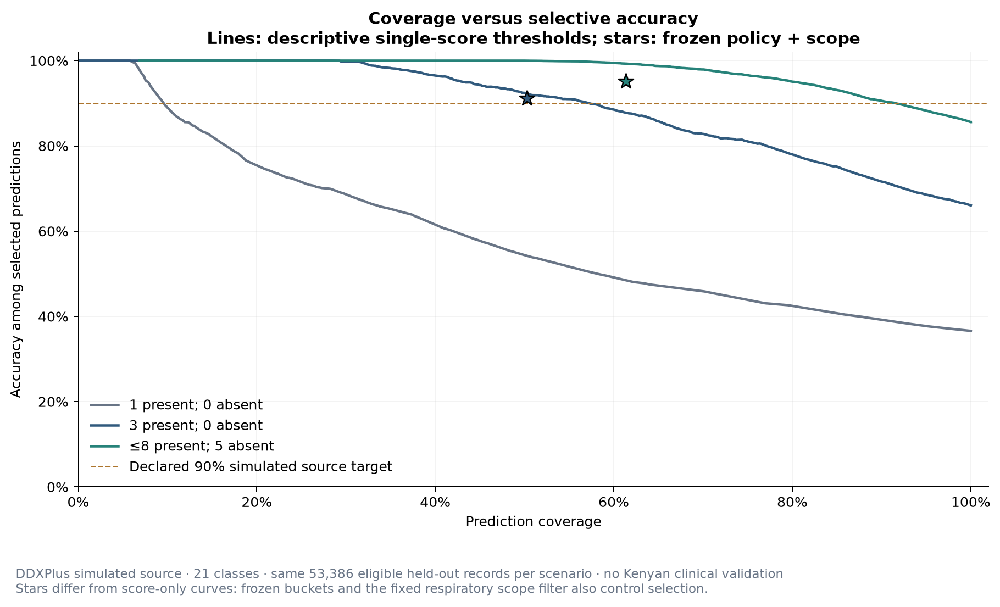
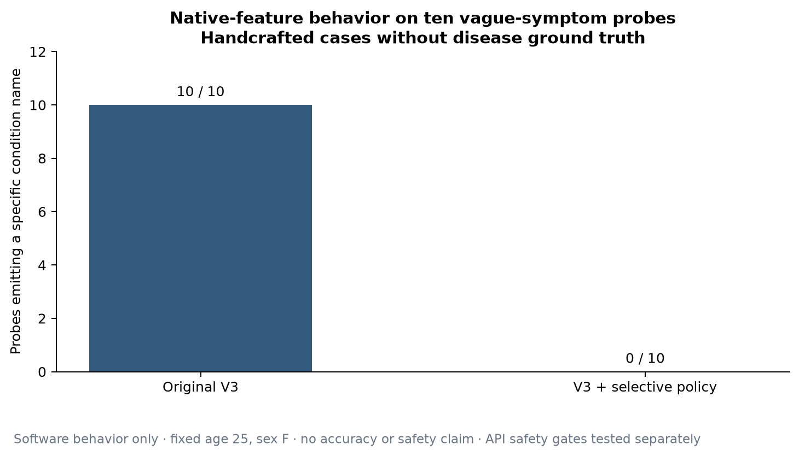
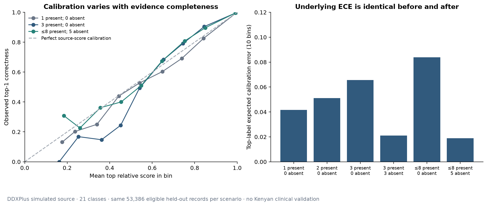

# Current V3 versus selective primary result: measured evaluation

The V3 model is unchanged. The new decision rule shows one possible condition only for selected source-like evidence patterns and otherwise asks for more information. Improved accuracy among selected cases is obtained by abstaining; learned model accuracy, probability calibration and class coverage have not improved. These are simulated DDXPlus results, not validation on Kenyan patients.

## Baseline and independent source partitions

Original means the currently integrated V3 age-stratified missing-evidence likelihood model, before this request. It uses 34 native features and 21 source classes, age groups with shrinkage 1000 and temperature 0.75 selected previously on tuning NLL. It marginalizes unmentioned features; only explicit no responses become negative evidence. It previously emitted three rankings for any positive feature and marked every result uncertain. The artifact SHA-256 remains `ae709ef5ddf6dd7a101fe426b610c3e83ef58aa93cb895ca13e7500220dc889c`.

Original source training: 443,075 rows. Original tuning: 26,477 rows; 26,432 unique full-198-feature source profiles select policy thresholds. Previously reporting-only validation is split by full source signature: `%4 == 1` gives 13,507 unique profiles for checking the frozen thresholds; `%4 == 3` gives 12,905 unique profiles for separate reporting validation. One first row per profile is chosen without inspecting its label. Whole original source-validation signatures remain excluded from test. Test retains 53,387 records / 53,273 unique profiles; one record has no supported positive feature. Matched disease-ranking results use the same 53,386 positive-evidence cases as the earlier V3 evaluation; both systems decline a disease for the remaining record.

Source duplicates cannot cross training, tuning, independent bound checking, reporting validation or test. Each calibration bucket has exactly one deterministic masked view per unique source profile. The same source may contribute to different buckets; multiple-testing correction does not require independence between buckets. Different sparse scenarios are separate experiments on overlapping test cases and must never be added as independent patients.

## Policy and interpretation

A declared engineering target of at most 10% error among selected simulated-source predictions drives threshold selection. This is a research risk budget, not an accepted medical threshold or a patient confidence percentage. For each of 48 exact evidence-count buckets (1–8 positive; 0–5 explicit negative), original tuning selects the score threshold with maximum coverage whose exploratory one-sided 95% exact-binomial bound meets that target. Complete score ties stay together. That chosen threshold is frozen before independently checking it on the separate source-profile cohort. A one-sided Clopper–Pearson error upper bound uses delta=0.05/48. A bucket is enabled only if that bound is ≤0.10; 34/48 passed. Failed buckets are disabled without retuning. The family-wise 95% interpretation requires independent exchangeable source profiles and the same sparse reporting mechanism. It is not a clinical guarantee.

The portable function `classify_primary(present, absent, age, sex)` returns eligible / uncertain / no_information, at most one condition, reasons, evidence counts, and internal diagnostics. It removes relative scores from its primary-result object. Unsupported evidence-count combinations abstain. Contradictory native evidence and unsupported features are rejected for correction. A fixed complaint-domain gate also requires a present respiratory anchor: generic fever, pain, muscle aches and fatigue alone cannot identify that the complaint is in the model's respiratory scope. This scope filter was specified from the supported complaint domain, without tuning thresholds on test outcomes. It is not a disease exclusion or triage test. Language confirmation and emergency gates remain separate application requirements.

The source-profile bound checks above concern the original pre-scope bucket policy. Filtering that selected cohort by respiratory scope changes the conditional error population, so the original bound is not automatically inherited. Actual scoped-policy metrics are reported below, with the pre-scope results shown separately for transparency. `scoped_calibration_diagnostics` records post-filter source-profile counts and bounds. A separate `v3_primary_scope.json` override disables bucket 1:4 (one positive / four negatives), whose scoped source-validation upper error bound was 0.1042336 and exceeded the declared 0.10 target. Anchors were fixed from the complaint domain before reviewing this scoped calibration result. No score threshold changed; reporting-validation and test labels never choose this override. Additional application language, severity and emergency gates are not measured by these source checks, so no clinical or full-application risk guarantee is claimed.

Calibration was evaluated, not assumed. V3 already has a tuning-selected temperature; it was retained. ECE changes with evidence completeness and does not validate a score for an individual patient. No new percentage is exposed to patients. Split conformal was considered, but it would require separate calibration independent of V3 selection and its marginal set coverage would not by itself certify accuracy conditional on singleton selection; direct source-profile selective-risk checks address the stated output decision more directly.

## Matched headline comparison

Three present symptoms and no explicitly absent features; N=53,386 in both columns. Macro averages include all 21 classes, including classes with no accepted primary. For the full decision-output precision/recall/F1, an abstention is a false negative for the true class. Accepted-only precision/recall/F1 are additional diagnostic fields, not replacements for these full-cohort results.

| Metric | Original V3 | V3 + selective policy | Change | Interpretation |
|---|---:|---:|---:|---|
| Underlying top-1 accuracy | 66.04% | 66.04% | +0.00 pp | Unchanged frozen model |
| Underlying top-3 accuracy | 94.83% | 94.83% | +0.00 pp | Ranking benchmark only; three labels no longer shown |
| Macro precision, full decision output | 83.25% | 80.83% | -2.41 pp | All 21 classes; abstentions are excluded from predicted positives |
| Macro recall, full decision output | 63.60% | 42.59% | -21.01 pp | All cases; abstentions count as missed true classes |
| Macro F1, full decision output | 66.56% | 52.42% | -14.13 pp | All cases, all 21 classes |
| Macro specificity on accepted cases | 98.17% | 99.52% | +1.35 pp | One-vs-rest diagnostic; changes cohort and is not triage specificity |
| Prediction coverage | 100.00% | 50.24% | -49.76 pp | Fewer cases receive a disease label |
| Selective accuracy | 66.04% | 91.22% | +25.18 pp | Accuracy conditional on a displayed primary |
| Abstention rate | 0.00% | 49.76% | +49.76 pp | No condition name; uncertainty is not reassurance |
| Correct primary / all cases | 66.04% | 45.83% | -20.21 pp | Prevents selective accuracy being mistaken for full-population accuracy |
| Top-label ECE (10 equal-width bins) | 0.0657 | 0.0657 | +0.0000 | Same source-relative score distribution; lower is better |
| Multiclass Brier score (sum over classes) | 0.3797 | 0.3797 | +0.0000 | Same source-relative score distribution; lower is better |
| Multiclass log loss | 0.6713 | 0.6713 | +0.0000 | Same source-relative score distribution; lower is better |

## Trade-off across all matched scenarios

| Reported evidence | Cases | Original top-1 | Original top-3 | New coverage | New selective accuracy | New abstention |
|---|---:|---:|---:|---:|---:|---:|
| 1 present; 0 absent | 53,386 | 36.60% | 68.44% | 0.00% | N/A (no selected cases) | 100.00% |
| 2 present; 0 absent | 53,386 | 53.34% | 86.89% | 24.89% | 91.44% | 75.11% |
| 3 present; 0 absent | 53,386 | 66.04% | 94.83% | 50.24% | 91.22% | 49.76% |
| 3 present; 3 absent | 53,386 | 72.69% | 96.49% | 0.00% | N/A (no selected cases) | 100.00% |
| ≤8 present; 0 absent | 53,386 | 78.12% | 97.03% | 60.89% | 95.57% | 39.11% |
| ≤8 present; 5 absent | 53,386 | 85.58% | 98.51% | 61.36% | 95.14% | 38.64% |

Scoped results above include the actual portable respiratory-domain filter. The same frozen score policy before that filter gives:

| Reported evidence | Pre-scope coverage | Pre-scope selective accuracy | Scoped coverage | Scoped selective accuracy |
|---|---:|---:|---:|---:|
| 1 present; 0 absent | 0.00% | N/A (no selected cases) | 0.00% | N/A (no selected cases) |
| 2 present; 0 absent | 29.71% | 91.22% | 24.89% | 91.44% |
| 3 present; 0 absent | 54.49% | 91.09% | 50.24% | 91.22% |
| 3 present; 3 absent | 0.00% | N/A (no selected cases) | 0.00% | N/A (no selected cases) |
| ≤8 present; 0 absent | 61.23% | 95.53% | 60.89% | 95.57% |
| ≤8 present; 5 absent | 61.67% | 95.14% | 61.36% | 95.14% |

The exact 3-positive / 3-negative bucket failed the independent source-validation bound and remains disabled; its complete abstention is intentional. Some other counts are similarly disabled. Eight-positive scenarios mean up to eight features: source cases with fewer positives use their exact observed-count policy. More symptoms or negative answers need not monotonically enable a primary result; different buckets have different source evidence and independent checks.

All full matrices and per-class precision/recall/F1, true support, accepted support, coverage, abstentions and one-vs-rest accepted specificity are exported to CSV. Low class-specific recall and coverage remain visible. High macro specificity in a 21-class task is dominated by many one-vs-rest negatives; it is not evidence of safe exclusion of serious disease.

## Class composition and coverage for the headline scenario

The same true-class composition is used before and after selection. These are source labels, not Kenyan disease frequencies. Coverage is the fraction of true-class cases allowed a primary; recall counts all cases including abstentions.

| Simulated source class | Test cases | Primary coverage | Recall including abstention |
|---|---:|---:|---:|
| Acute COPD exacerbation / infection | 1,729 | 37.59% | 33.55% |
| Acute laryngitis | 3,217 | 54.90% | 54.90% |
| Acute pulmonary edema | 2,598 | 89.61% | 89.61% |
| Acute rhinosinusitis | 1,829 | 37.23% | 14.65% |
| Allergic sinusitis | 1,294 | 93.89% | 93.89% |
| Bronchiectasis | 2,224 | 0.99% | 0.00% |
| Bronchiolitis | 34 | 29.41% | 0.00% |
| Bronchitis | 3,594 | 50.08% | 35.03% |
| Bronchospasm / acute asthma exacerbation | 1,761 | 5.39% | 5.39% |
| Chronic rhinosinusitis | 2,747 | 40.04% | 39.90% |
| Croup | 236 | 66.53% | 38.98% |
| Epiglottitis | 2,364 | 93.27% | 92.68% |
| Influenza | 3,554 | 43.64% | 25.75% |
| Larygospasm | 197 | 0.00% | 0.00% |
| Pneumonia | 3,542 | 56.13% | 51.02% |
| Pulmonary neoplasm | 1,894 | 70.12% | 65.26% |
| Spontaneous pneumothorax | 1,343 | 55.40% | 49.74% |
| Tuberculosis | 1,865 | 43.16% | 30.99% |
| URTI | 8,743 | 60.57% | 60.57% |
| Viral pharyngitis | 8,330 | 34.24% | 34.19% |
| Whooping cough | 291 | 78.35% | 78.35% |

## Handcrafted vague-symptom behavior

Ten native-feature vague probes produce specific labels in 10/10 original V3 outputs and 0/10 selective outputs. These are behavior counts, not unsupported-disease error rates: no clinical diagnosis or reviewed reference outcome exists for these descriptions. They cannot establish diagnostic accuracy, missed emergencies, appropriate reassurance or unnecessary escalation. The native suite explicitly records inputs and includes the native respiratory-anchor filter; it bypasses NLP, additional API input-context and emergency gates, which require full application tests. The two informative probes still emit one possible source condition when the source policy allows it.

| Native probe | Original top-3 ranking | Selective result |
|---|---|---|
| Headache alone | URTI; Influenza; Chronic rhinosinusitis | uncertain |
| Tiredness alone | Pulmonary neoplasm; Whooping cough; Spontaneous pneumothorax | uncertain |
| Headache and tiredness | Acute rhinosinusitis; Pulmonary neoplasm; Chronic rhinosinusitis | uncertain |
| Mild fever and headache | URTI; Influenza; Acute rhinosinusitis | uncertain |
| Cough and sore throat | URTI; Bronchitis; Influenza | uncertain |
| Fever, cough, sore throat, body aches | URTI; Influenza; Pneumonia | uncertain |
| Fever alone | URTI; Viral pharyngitis; Influenza | uncertain |
| Cough alone | URTI; Viral pharyngitis; Bronchitis | uncertain |
| Sore throat alone | URTI; Influenza; Bronchitis | uncertain |
| Body aches alone | URTI; Pneumonia; Influenza | uncertain |
| Itchy nose and itchy eyes | Allergic sinusitis; Bronchiolitis; Whooping cough | Allergic sinusitis |
| Coughing fits and vomiting after cough | Whooping cough; Bronchiolitis; Spontaneous pneumothorax | Whooping cough |
| Empty evidence | insufficient_evidence | no_information |
| Explicit no fever; no positive symptom | insufficient_evidence | no_information |
| Unsupported native feature | invalid | invalid |
| Contradictory fever | invalid | invalid |
| Potential emergency: breathlessness and chest pain | Acute pulmonary edema; Bronchitis; Pneumonia | uncertain |

## Visualizations












All figures also have reusable SVG exports. Coverage curves are descriptive test sensitivity analyses; no threshold is chosen from them.

## Reproduce

From the ML repository, using its installed virtual environment:

```powershell
.venv/Scripts/python.exe scripts/evaluate_primary_selection.py --baseline
.venv/Scripts/python.exe scripts/evaluate_primary_selection.py
.venv/Scripts/python.exe scripts/render_primary_selection_report.py
.venv/Scripts/python.exe -m pytest tests -q
```

For report reproduction without refitting selection, use `evaluate_primary_selection.py --evaluate-only`. The unchanged V3 hash, separate frozen score-policy hash, and scope-override hash are recorded. The first run reads source CSVs and caches compact cohorts in `data/processed/primary_selection_cache`; later runs validate source file size/mtime/schema before reusing that cache. Source CSVs and the ignored local cache are not redistributed. Labels and masks come from authentic simulated source data, never fabricated disease ground truth. Statistical metrics are deterministic; PNG/SVG file metadata can vary between renders. Use the explicit `tests` directory: bare pytest collection currently also discovers a pre-existing non-UTF8 readable data text file as a doctest and fails decoding it.

## Remaining limitations and decisions requiring review

The source generator's disease frequencies and New York census assumptions do not represent Kenyan prevalence. Many locally important diagnoses, including malaria, are not in these 21 classes; an apparently decisive closed-set score can be wrong outside the vocabulary. Random masking of complete simulated evidence differs from human symptom reporting. Severity and duration are not learned model inputs. There is no Kenyan cohort, clinician-reviewed symptom vignette set, validated emergency reference, prospective safety outcome study or patient comprehension study. The predeclared 90% source target needs clinical governance before any patient use; disabling failed buckets is a software safeguard, not proof of safety. Local prospective data, mapping review, subgroup analysis, triage review and prevalence-shift validation are required before a clinical claim.

## Method references

- [DDXPlus original dataset paper](https://proceedings.neurips.cc/paper_files/paper/2022/hash/cae73a974390c0edd95ae7aeae09139c-Abstract.html): simulated records and the limits of source-only evidence. [Full paper](https://papers.nips.cc/paper/2022/file/cae73a974390c0edd95ae7aeae09139c-Paper-Datasets_and_Benchmarks.pdf), section 3.2 describes generation and demographic assumptions.
- [NIST exact binomial confidence limits](https://itl.nist.gov/div898/software/dataplot/refman2/auxillar/exacbino.htm): one-sided error-bound method; combined here with separate source-profile checks and Bonferroni correction.
- [Selective Classification for Deep Neural Networks, Geifman and El-Yaniv (2017)](https://proceedings.neurips.cc/paper/2017/hash/4a8423d5e91fda00bb7e46540e2b0cf1-Abstract.html): selective prediction trades coverage for lower error; this implementation retains the existing likelihood model.
- [Classification with Valid and Adaptive Coverage, Romano et al. (2020)](https://proceedings.neurips.cc/paper_files/paper/2020/hash/244edd7e85dc81602b7615cd705545f5-Abstract.html): alternative set-valued uncertainty method; marginal prediction-set coverage is distinct from selected-only correctness.
